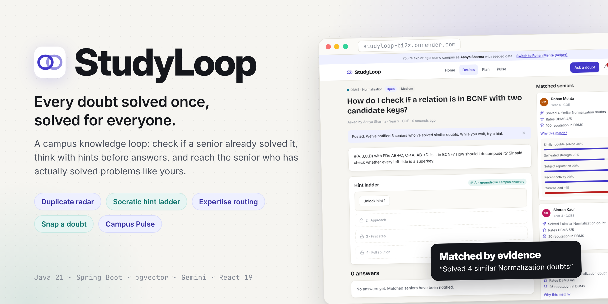
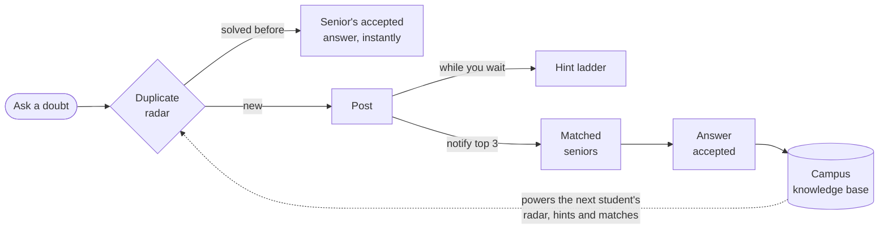
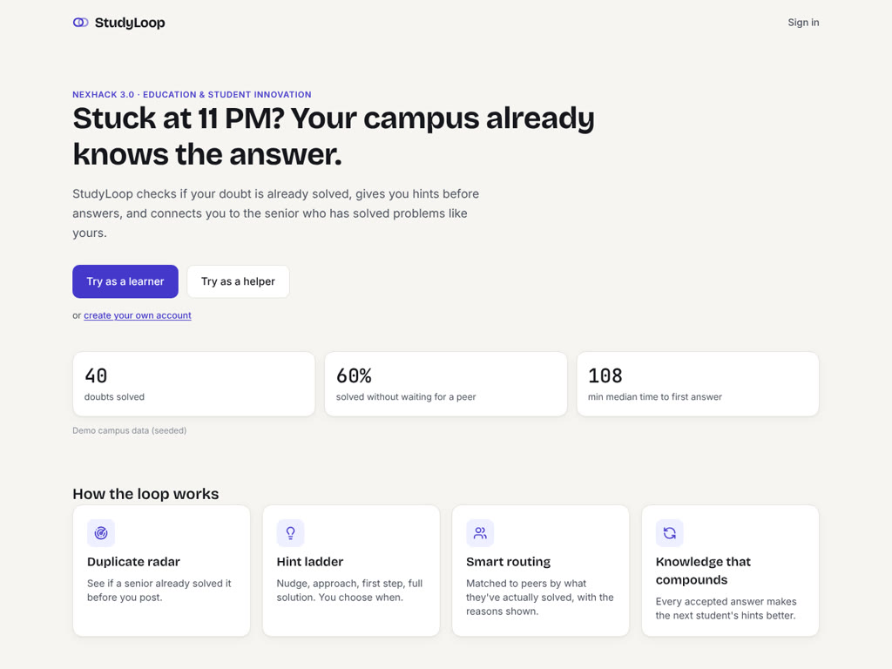
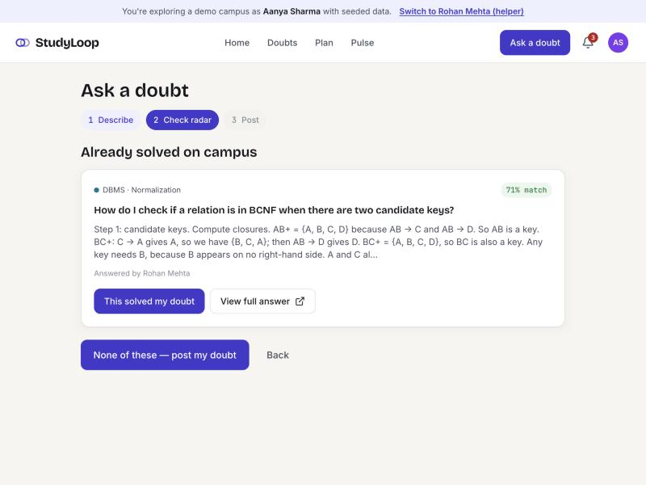
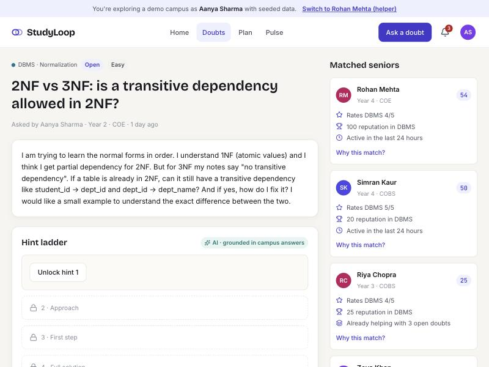
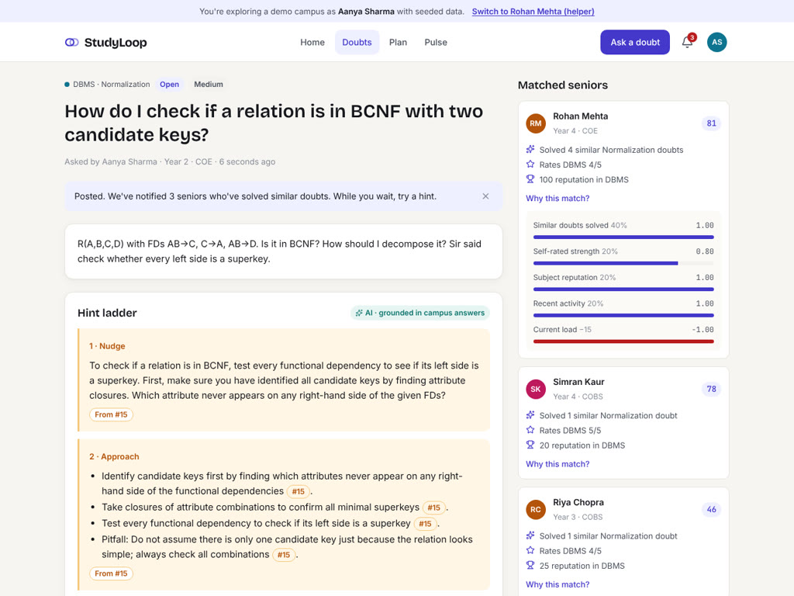
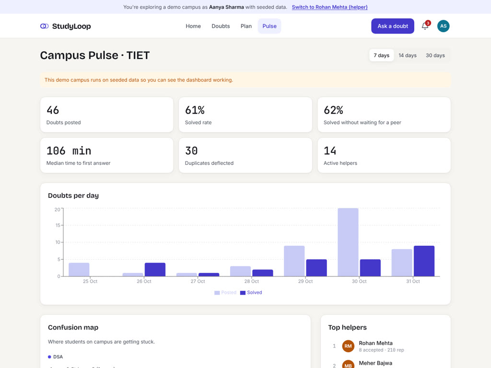
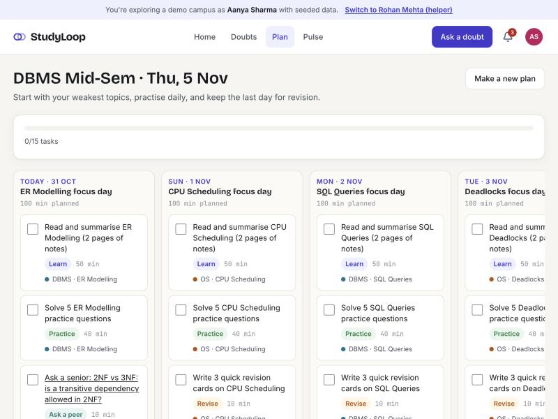
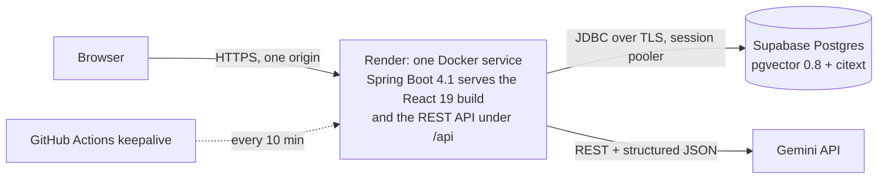
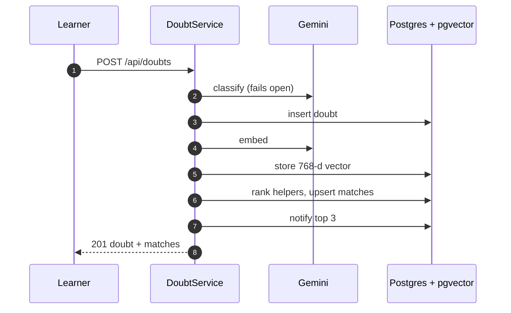

<div align="center">



<p>
  <a href="https://github.com/Kavaykhurana/studyloop/actions/workflows/ci.yml"></a>
  <a href="https://studyloop-bi2z.onrender.com"></a>
  <a href="https://studyloop-bi2z.onrender.com/api/docs"></a>
  
  
  
  
  
</p>

**[Live demo](https://studyloop-bi2z.onrender.com)** · **[API docs](https://studyloop-bi2z.onrender.com/api/docs)** · **[Architecture](docs/ARCHITECTURE.md)** · **[Run locally](#getting-started)** · **[Team](#team)**

<sub>Built by Team AlphaFire for NexHack 3.0 · Track 2: Education and Student Innovation</sub>

</div>

<br>

StudyLoop turns every doubt solved on campus into knowledge for the next student. It checks whether your doubt is
already solved, makes you think with hints before it shows an answer, and routes you to the senior who has actually
solved problems like yours. Each accepted answer then powers the radar and the hints for whoever asks next.

<details>
<summary><b>Table of contents</b></summary>

- [The problem](#the-problem)
- [Try it](#try-it)
- [How it works](#how-it-works)
- [Features](#features)
- [Screenshots](#screenshots)
- [Architecture](#architecture)
- [The matching algorithm](#the-matching-algorithm)
- [Tech stack](#tech-stack)
- [Project structure](#project-structure)
- [Getting started](#getting-started)
- [Configuration](#configuration)
- [Testing](#testing)
- [Deployment](#deployment)
- [API](#api)
- [Security](#security)
- [AI usage disclosure](#ai-usage-disclosure)
- [Team](#team)
- [Acknowledgements](#acknowledgements)
- [Roadmap](#roadmap)

</details>

## The problem

Engineering students at Indian colleges get stuck late at night before mid-sems and lab evaluations. Their options are
noisy batch WhatsApp groups, where a doubt is buried within minutes, the same doubt comes back every semester and
nothing is searchable; seniors they do not know how to reach; or a general chatbot that hands over the final answer,
which helps them submit but not learn. The knowledge seniors shared once is lost every year.

## Try it

Open **[studyloop-bi2z.onrender.com](https://studyloop-bi2z.onrender.com)** and click **Try as a learner** or **Try as a
helper**. No signup is needed: both personas belong to a seeded demo campus with 60 doubts and 75 answers, and every AI
feature runs on live Gemini.

> [!NOTE]
> The free Render instance sleeps when idle, so the first visit can take up to two minutes to wake it. After that,
> everything responds instantly.

A two-minute tour:

1. **Try as a learner**, then **Ask a doubt** with the title `How do I check if a relation is in BCNF with two candidate
   keys?`. Before anything is posted, the duplicate radar finds the senior answer that already solves it.
2. Ask something it has not seen and post it. The doubt page shows the matched seniors with **Why this match?** and a
   hint ladder that cites campus answers.
3. Click **Switch to Rohan Mehta (helper)** in the demo bar, answer the doubt, switch back and accept the answer.
   Reputation is awarded, and the answer joins the knowledge base.
4. Open **Pulse** for the campus confusion map and **Plan** for an AI study plan built from your doubts.

## How it works



1. **Ask.** Type a doubt (Markdown and code supported) or snap a photo of your notebook; Gemini transcribes it into an
   editable doubt.
2. **Duplicate radar.** Before posting, StudyLoop semantically searches doubts already solved on your campus and shows
   the closest matches with the accepted answer. "This solved my doubt" is logged as a deflection.
3. **Hint ladder.** After posting, unlock up to four AI rungs: Nudge, Approach, First step, Full solution. Rungs are
   grounded in accepted answers from seniors on the same campus and cite them as `[#42]`.
4. **Smart routing.** Peers are ranked by what they have actually solved, plus declared strength, subject reputation,
   recent activity and current load. The top three are notified, and every match shows why.
5. **Answer, then accept.** A helper answers, the learner accepts, reputation is awarded through an idempotent ledger,
   and the doubt joins the campus knowledge base that powers the next student's radar and hints. That is the loop.
6. **Campus Pulse.** Doubts posted, solved rate, share solved without waiting for a peer, median time to first answer,
   and a confusion map of the topics students are stuck on this week.
7. **Study planner.** A dated plan to an exam, built from your weak subjects and your own recent doubts, with tickable
   tasks.

## Features

| Feature | What it does | How it's built |
|---|---|---|
| Duplicate radar | Shows solved senior doubts that match yours before you post | pgvector cosine search over 768-d Gemini embeddings, HNSW index, campus-scoped |
| Socratic hint ladder | Four rungs that make you think before you see the answer | Gemini structured output, rungs cached per doubt, citations validated against the ids supplied |
| Explainable routing | Ranks helpers by evidence, shows the reasons and a score breakdown | Hybrid score of semantic proof, declared level, subject reputation, recency and load ([below](#the-matching-algorithm)) |
| Snap a doubt | Photo to editable doubt | Gemini vision, magic-byte validation, image never stored |
| Reputation ledger | Points for accepted, fast and well-rated answers | Append-only `reputation_events`, `ON CONFLICT DO NOTHING`, pessimistic lock on accept |
| Notifications | Matched, new answer, answer accepted | In-app, 15 s polling (no WebSockets by design) |
| Campus Pulse | Confusion map, self-serve rate, time to first answer, top helpers | SQL aggregates over the campus, seeded-data label on every demo metric |
| AI study planner | Day-by-day plan with an ask-a-peer task for your open doubt | Gemini output validated and trimmed to your daily budget |
| One-click demo | Learner and helper personas on a seeded TIET campus | Seeder with ledger-derived reputation, admin reset endpoint |
| Multi-campus | Email domain decides the campus; content never crosses campuses | `campus_id` filter on every query, 404 (not 403) for other campuses |

## Screenshots

Captured on the seeded demo campus with Gemini: the radar scores, routing reasons, hint rungs (with their campus
citation chips) and the study plan are live model and pgvector output.

| | |
|---|---|
|  |  |
| Landing with live (seeded) stats | Duplicate radar finds a solved senior answer |
|  |  |
| Matched seniors with scores and reasons | Hint ladder: a nudge, then approach bullets citing a senior's answer |
|  |  |
| Campus Pulse | Study planner |

## Architecture



The React app is built inside the same Docker image and served by Spring Boot, so the UI and the API share one origin:
the `HttpOnly` refresh cookie is first-party (works in Safari), and there is no CORS in production.



The ER model, token rotation, hint ladder design, embedding-space versioning and live API measurements are in
[docs/ARCHITECTURE.md](docs/ARCHITECTURE.md).

## The matching algorithm

```
score = round(100 * (0.40*semantic + 0.20*declared + 0.20*reputation + 0.20*recency) - 15*load), clamped to 0..100
```

| Signal | Why it exists |
|---|---|
| `semantic` (0.40) | Best similarity to doubts the helper has already solved with an *accepted* answer. Self-declared level is easy to game; solved similar doubts are evidence. |
| `declared` (0.20) | Self-rated strength (level / 5). Lets new helpers with no history still be found. |
| `reputation` (0.20) | `ln(1 + subjectRep) / ln(1 + maxSubjectRep)`. Log scale so one veteran does not drown everyone. |
| `recency` (0.20) | Active in 24 h = 1.0, 72 h = 0.6, 7 d = 0.3. A great helper who left last month will not answer tonight. |
| `load` (-15) | Open matches in the last 48 h. Spreads questions instead of burying the best helper. |

Ranks 1 to 3 with a score of at least 25 are notified, once. Each match stores the five components and up to three
plain-English reasons, shown behind "Why this match?".

## Tech stack

| Layer | Technology |
|---|---|
| Backend | Java 21 (virtual threads), Spring Boot 4.1, Spring Web MVC, Spring Security 7 with OAuth2 Resource Server (Nimbus HS256) |
| Persistence | Spring Data JPA (Hibernate 7) for entities, `JdbcTemplate` for vectors and analytics, Flyway migrations with `ddl-auto=validate` |
| Database | PostgreSQL with `pgvector` and `citext` (Supabase in production, `pgvector/pgvector:pg16` locally and in tests) |
| AI | Gemini REST API via `RestClient` with structured JSON output: `gemini-3.5-flash-lite` (hints, snap, planner), `gemini-3-flash-preview` (classification), `gemini-embedding-2` at 768 dimensions; per-tier thinking levels, cross-model fallback (all configurable) |
| API docs | springdoc-openapi at `/api/docs` |
| Frontend | React 19, TypeScript (strict), Vite, Tailwind CSS v4, React Router 7, TanStack Query v5, Axios, react-hook-form + zod, react-markdown with rehype-sanitize and highlight, Recharts, sonner |
| Tests | JUnit 5, Mockito, AssertJ, Testcontainers (`pgvector/pgvector:pg16`) |
| Delivery | One Docker image on Render (SPA + API), GitHub Actions (`ci.yml`, `keepalive.yml`) |

## Project structure

```
studyloop/
├── backend/                          Spring Boot API (Java 21, Maven)
│   └── src/
│       ├── main/java/com/studyloop/
│       │   ├── auth/                 access tokens, rotating refresh tokens, reuse detection
│       │   ├── campus/               campus resolved from the email domain
│       │   ├── user/ subject/        profiles, subject strengths, subject catalogue
│       │   ├── doubt/ answer/        doubts, feed and search; answers and the race-safe accept
│       │   ├── reputation/           idempotent reputation ledger
│       │   ├── notification/         in-app notifications
│       │   ├── ai/                   Gemini client, prompts, JSON schemas, snap, offline fake AI
│       │   ├── embedding/            pgvector store, backfill job, embedding-space guard
│       │   ├── matching/             helper ranking and "Why this match?" reasons
│       │   ├── hint/ plan/ pulse/    hint ladder, study planner, Campus Pulse analytics
│       │   ├── seed/                 demo campus seeder and reset endpoint
│       │   ├── common/ config/       errors, rate limits, security, SPA serving
│       │   └── health/               /api/health: readiness, AI mode, deployed commit
│       ├── main/resources/           application.yml, Flyway migrations V1 to V4, seed doubts
│       └── test/                     unit and Testcontainers integration tests
├── frontend/                         React 19, TypeScript, Vite, Tailwind CSS v4
│   └── src/
│       ├── pages/                    one file per screen: landing, ask, doubt, feed, pulse, plan
│       ├── components/               doubts, plan, pulse, layout and the UI kit
│       ├── hooks/                    TanStack Query hooks per resource
│       └── lib/                      API client, auth context, shared types
├── docs/                             architecture, AI usage, attribution, contributions
│   ├── assets/ screenshots/          banner and app screenshots
│   └── hackathon/                    NexHack submission pack and demo script
├── scripts/                          smoke.sh (post-deploy checks), calibrate_similarity.py
├── .github/workflows/                ci.yml, keepalive.yml (warm-up ping, live smoke test)
├── Dockerfile                        builds the SPA and bundles it into the Spring Boot jar
├── render.yaml                       Render Blueprint for the live service
└── docker-compose.yml                local PostgreSQL 16 with pgvector
```

## Getting started

Prerequisites: Java 21, Node 22 and Docker.

```bash
# 1. Database (PostgreSQL 16 with pgvector)
docker compose up -d

# 2. Backend
cd backend
cp .env.example .env
# set JWT_SECRET in .env:  openssl rand -base64 48
set -a; source .env; set +a
./mvnw spring-boot:run -Dspring-boot.run.profiles=local

# 3. Frontend (new terminal)
cd frontend
npm ci
npm run dev
```

Open http://localhost:5173. With `DEMO_MODE=true` and `SEED_DEMO=true` (the defaults in `.env.example`) the demo campus
is seeded on first start and the landing page buttons log you in as the demo learner or helper.

> [!TIP]
> No Gemini key is needed to run it. Without `GEMINI_API_KEY` the app uses **deterministic fake AI**, so everything
> works offline: a keyword classifier picks the subject and topic, a bag-of-words embedder powers the radar and routing,
> and hints are rung-shaped and cite the closest campus answer. A separate threshold set (`SIM_FAKE_*`) applies
> automatically because the fake embedder scores lower than Gemini. Add a key and the Gemini thresholds apply; on the
> next start every stored vector made by another model is re-embedded automatically (see "Embedding space" in
> [docs/ARCHITECTURE.md](docs/ARCHITECTURE.md)).

To run the single-service image that Render runs:

```bash
docker build -t studyloop . && docker run -p 8080:8080 --env-file backend/.env studyloop
```

Then open http://localhost:8080.

## Configuration

All configuration comes from environment variables. For local development they live in `backend/.env`, which is never
committed.

<details>
<summary><b>Backend environment variables</b></summary>
<br>

| Variable | Default | Purpose |
|---|---|---|
| `DATABASE_URL` / `DATABASE_USER` / `DATABASE_PASSWORD` | local compose values | JDBC connection (hosted Postgres: add `?sslmode=require`) |
| `JWT_SECRET` | none, required | Base64, at least 32 bytes. `openssl rand -base64 48` |
| `ACCESS_TOKEN_TTL_MINUTES` / `REFRESH_TOKEN_TTL_DAYS` | 15 / 7 | Token lifetimes |
| `COOKIE_SECURE` | false | Set `true` behind HTTPS |
| `GEMINI_API_KEY` | blank | Blank means fake AI (dev and tests only) |
| `GEMINI_BASE_URL` | Gemini v1beta | API base |
| `GEMINI_CHAT_MODEL` / `GEMINI_FAST_MODEL` / `GEMINI_EMBED_MODEL` | `gemini-3.5-flash-lite` / `gemini-3-flash-preview` / `gemini-embedding-2` | Chat: hints, snap, planner. Fast: classification. Each is the other's fallback. Resolved against Gemini's live model list at startup (a missing id falls back to its closest listed variant, e.g. `-preview`). Chosen from latency measurements on the live API (docs/ARCHITECTURE.md, section 11) |
| `GEMINI_CHAT_THINKING` / `GEMINI_FAST_THINKING` | `low` / `minimal` | Gemini 3 thinking level per tier (blank sends none). Without it these models think for 30 s+ per call; a level a model rejects is stepped down automatically |
| `SIM_DUPLICATE_THRESHOLD` / `SIM_GROUNDING_THRESHOLD` | 0.82 / 0.72 | Cosine thresholds, calibrated on `gemini-embedding-2` with `scripts/calibrate_similarity.py` |
| `SIM_SEMANTIC_FLOOR` / `SIM_SEMANTIC_CEIL` | 0.64 / 0.75 | Rescaling range for the semantic signal (10th / 90th percentile of the routing signal) |
| `SIM_FAKE_DUPLICATE_THRESHOLD` / `SIM_FAKE_GROUNDING_THRESHOLD` / `SIM_FAKE_SEMANTIC_FLOOR` / `SIM_FAKE_SEMANTIC_CEIL` | 0.45 / 0.30 / 0.20 / 0.60 | Same four, used only when `GEMINI_API_KEY` is blank (calibrated for the fake embedder) |
| `DEMO_MODE` / `SEED_DEMO` | false / false | Enables demo login / seeds the demo campus when empty |
| `ADMIN_TOKEN` | blank | Enables `POST /api/admin/demo/reset` (header `X-Admin-Token`); blank returns 404 |
| `ALLOWED_ORIGINS` | `http://localhost:5173` | CORS, local development only |
| `SERVER_PORT` | 8080 | Port (Render's `PORT` overrides it in Docker) |

</details>

<details>
<summary><b>Frontend environment variables</b></summary>
<br>

| Variable | Default | Purpose |
|---|---|---|
| `VITE_API_PROXY_TARGET` | `http://localhost:8080` | Dev-server proxy target for `/api` |
| `VITE_GITHUB_URL` | none | Optional footer link |

</details>

## Testing

```bash
cd backend && ./mvnw verify
```

75 tests run against a real PostgreSQL with pgvector (Testcontainers; set `TEST_DATABASE_URL`, `TEST_DATABASE_USER`
and `TEST_DATABASE_PASSWORD` to use an existing database when Docker is unavailable).

<details>
<summary><b>What the backend tests cover</b></summary>
<br>

- Signup, login and refresh rotation with reuse detection and the concurrent-refresh grace
- Campus isolation
- Accept under a concurrent race: exactly one winner, and the ledger equals reputation
- Idempotent reputation
- Duplicate radar
- Peer matching: ranking, load, reasons, notify-once
- Hint ladder caching, citation validation and AI outage
- Study plan trimming and validation
- Rate limiting
- The feed query budget: three SQL statements for twenty doubts
- Error response shape and snap upload validation
- The Gemini client's request shape, retry, fallback and error mapping against a local stand-in server
- Gemini model-id resolution
- Embedding-space re-embedding after a model change
- The SPA fallback for the single-service build, and public Swagger UI

</details>

```bash
cd frontend && npm run typecheck && npm run lint && npm run build
```

CI runs both on every push and pull request to `main` and `dev`.

## Deployment

The live site runs as one Docker web service on Render (free plan, Singapore) with a Supabase Postgres database.

- **Image.** The root [`Dockerfile`](Dockerfile) builds the React app with Node 22, bundles it into the Spring Boot jar
  with Maven, and runs it on a Temurin 21 JRE, so the UI and the API share one origin.
- **Blueprint.** [`render.yaml`](render.yaml) describes the service as a Render Blueprint: the health check on
  `/api/health`, auto-deploy and every environment variable. Secrets (`DATABASE_*`, `GEMINI_API_KEY`) are entered in
  the Render dashboard, never committed; a Blueprint deploy generates `JWT_SECRET` and `ADMIN_TOKEN`.
- **Database.** Supabase Postgres through the session pooler, in a dedicated `studyloop` schema with its own role.
  Flyway migrates it on startup, and the demo campus is seeded when empty.
- **Keepalive and smoke test.** [`keepalive.yml`](.github/workflows/keepalive.yml) pings the site every 10 minutes so
  it stays warm. A manual run (**Actions → keepalive → Run workflow**) executes [`scripts/smoke.sh`](scripts/smoke.sh)
  against production: landing, SPA fallback, Swagger, auth guard, demo login, duplicate radar, feed, Pulse and refresh
  rotation, plus a live Gemini check (classification and a hint) from a throwaway account. It also runs locally:

```bash
scripts/smoke.sh https://studyloop-bi2z.onrender.com
```

## API

Interactive OpenAPI docs are public at **[/api/docs](https://studyloop-bi2z.onrender.com/api/docs)** (JSON at
`/api/docs/openapi.json`). **[/api/health](https://studyloop-bi2z.onrender.com/api/health)** returns the database state,
the AI mode (`GEMINI` or `FAKE`) and the deployed git commit, and answers 503 until the seeder and the embedding guard
are ready.

## Security

- **Tokens.** Access JWTs (15 min, HS256) live only in browser memory. The refresh token is an opaque 32-byte value in
  an `HttpOnly`, `SameSite=Lax`, path-scoped cookie; only its SHA-256 is stored.
- **Rotation and reuse detection.** Every refresh rotates the token. Replaying an old one revokes the whole token
  family and returns `REFRESH_REUSED`. A token rotated less than 15 seconds ago whose family is still active is treated
  as a concurrent refresh from the same browser (a reload while the previous refresh was in flight, two tabs booting)
  and gets a sibling token instead of a logout; after logout or a detected reuse the family is dead, so the grace never
  applies.
- **CSRF.** The only cookie-authenticated mutations (`refresh`, `logout`) require `X-Requested-With: StudyLoop`.
- **Passwords.** BCrypt strength 12; identical error for unknown email and wrong password.
- **Campus isolation.** Every doubt, feed, search, match, pulse and profile query is filtered by the caller's campus;
  other campuses get 404, never 403.
- **Input.** Markdown is stored raw and rendered through `rehype-sanitize`; bodies containing `<script` are rejected.
- **Rate limits** on login, signup, posting, answering, search, hints, snap and plans, with `Retry-After`.
- **No image storage.** Uploaded photos are validated by magic bytes, kept in memory, sent to Gemini and discarded.
- **No secrets in the repository.** Everything comes from environment variables; `.env` files are git-ignored.

## AI usage disclosure

AI tools were used heavily to build this project, and Gemini models power several product features. The full
disclosure, including what is and is not verified against the live Gemini API, is in
[docs/AI_USAGE.md](docs/AI_USAGE.md).

## Team

**Team AlphaFire**

| Member | Role | Owned |
|---|---|---|
| Kavay Khurana (team leader) · [@Kavaykhurana](https://github.com/Kavaykhurana) | Backend core and backend AI | Product plan and build spec; auth, doubts, answers, reputation ledger, notifications; Gemini layer, duplicate radar, matching, hint ladder, planner, Pulse, seed campus; deployment |
| Gurliv Singh | Frontend | The React app: landing and demo personas, Ask flow with radar and Snap, doubt page with hint ladder and matches, feed, Pulse, planner, design system |
| Harshit Atal | Backend AI and frontend | AI features end to end: radar, matching with "Why this match?", hint ladder, planner, Pulse |
| Tanveer Singh | Design, content and pitch | Docs, seeded campus content, demo video, Unstop submission |

Details per member: [docs/CONTRIBUTIONS.md](docs/CONTRIBUTIONS.md).

## Acknowledgements

StudyLoop is built on open-source components and external APIs, each used under its own licence: Spring Boot, Spring
Security, Hibernate, Flyway, PostgreSQL with pgvector, React, TanStack Query, Tailwind CSS, Recharts and others, the
Google Gemini API, and the Bricolage Grotesque, Inter and JetBrains Mono typefaces. The full list with versions and
licences is in [docs/ATTRIBUTION.md](docs/ATTRIBUTION.md).

## Roadmap

- Multi-college rollout through email domains (the campus model already supports it).
- A faculty view of the confusion map, so a class representative can act on it.
- A WhatsApp bot entry point, since that is where students already ask.
- Spaced-repetition revision built from each student's solved doubts.
