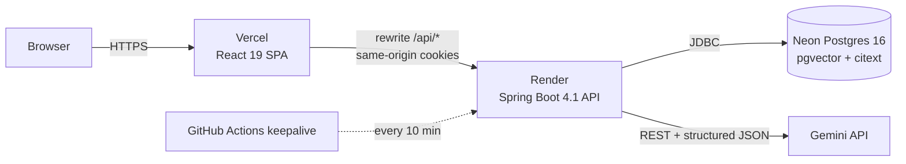
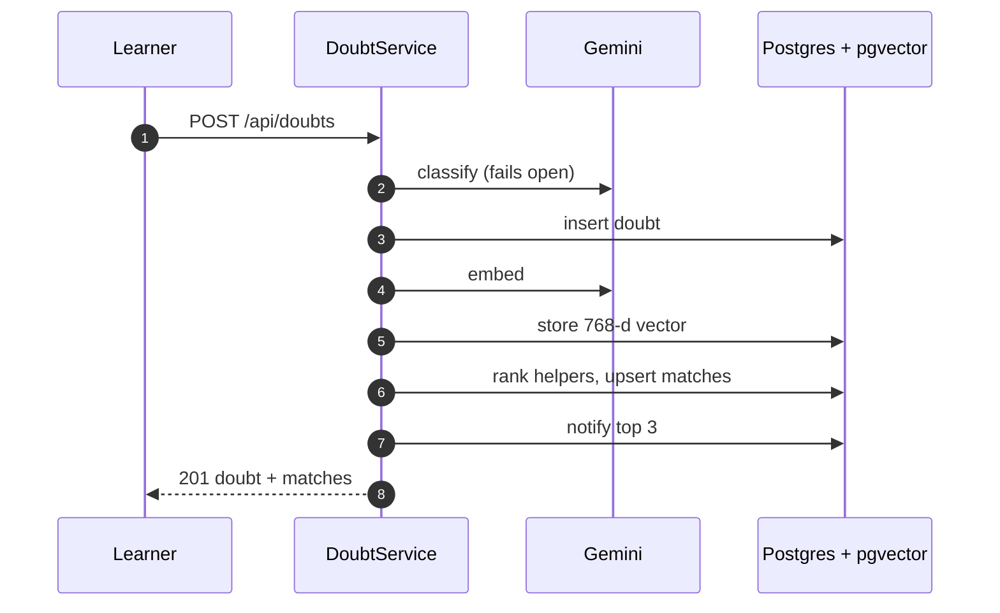

# StudyLoop

**Every doubt solved once, solved for everyone.** StudyLoop turns each doubt solved on campus into knowledge for the next
student: it checks whether your doubt is already solved, gives you hints before answers, and routes you to the senior
who has actually solved problems like yours.

[](https://github.com/OWNER/studyloop/actions/workflows/ci.yml)
[](https://studyloop.vercel.app)

NexHack 3.0 · Track 2: Education and Student Innovation

> Replace `OWNER` in the badge URLs with your GitHub account or organisation, and the Vercel URL if yours differs.

## Live demo

**https://studyloop.vercel.app** - click **Try as a learner** or **Try as a helper**. No signup needed.

Demo video: _add the unlisted YouTube link here_

First-load note: the API may take up to a minute to wake if idle.

## The problem

Engineering students at Indian colleges get stuck late at night before mid-sems and lab evaluations. Their options are
noisy batch WhatsApp groups, where a doubt is buried within minutes, the same doubt is asked every semester and nothing
is searchable; seniors they do not know how to reach; or a general chatbot that hands over the final answer, which helps
them submit but not learn. Knowledge that seniors already shared once is lost every year.

Survey highlights from real students are in [docs/SURVEY.md](docs/SURVEY.md) (the team adds the numbers there; none
are claimed here until they are collected).

## The solution

1. **Ask.** Type a doubt (Markdown and code supported) or snap a photo of your notebook; Gemini transcribes it into an
   editable doubt.
2. **Duplicate radar.** Before posting, StudyLoop semantically searches doubts already solved on your campus and shows
   the closest matches with the accepted answer. "This solved my doubt" is logged as a deflection.
3. **Hint ladder.** After posting, unlock up to four AI rungs: Nudge, Approach, First step, Full solution. Rungs are
   grounded in accepted answers from seniors on the same campus and cite them as `[#42]`.
4. **Smart routing.** Peers are ranked by what they have actually solved, plus declared strength, subject reputation,
   recent activity and current load. The top three are notified, and every match shows why.
5. **Answer, then accept.** A helper answers, the learner accepts, reputation is awarded through an idempotent ledger,
   and the doubt joins the campus knowledge base that powers the next student's radar and hints. That is the loop.
6. **Campus Pulse.** A live dashboard: doubts posted, solved rate, share solved without waiting for a peer, median time
   to first answer, and a confusion map of which topics students are stuck on this week.
7. **Study planner.** A dated plan to an exam, built from your weak subjects and your own recent doubts, with tickable
   tasks.

## Key features

| Feature | What it does | How it's built |
|---|---|---|
| Duplicate radar | Shows solved senior doubts that match yours before you post | pgvector cosine search over 768-d Gemini embeddings, HNSW index, campus-scoped |
| Socratic hint ladder | Four rungs that make you think before you see the answer | Gemini structured output, rungs cached per doubt, citations validated against the ids supplied |
| Explainable routing | Ranks helpers by evidence, shows the reasons and a score breakdown | Hybrid score of semantic proof, declared level, subject reputation, recency and load (see below) |
| Snap a doubt | Photo to editable doubt | Gemini vision, magic-byte validation, image never stored |
| Reputation ledger | Points for accepted, fast and well-rated answers | Append-only `reputation_events`, `ON CONFLICT DO NOTHING`, pessimistic lock on accept |
| Notifications | Matched, new answer, answer accepted | In-app, 15 s polling (no WebSockets by design) |
| Campus Pulse | Confusion map, self-serve rate, time to first answer, top helpers | SQL aggregates over the campus, seeded-data label on every demo metric |
| AI study planner | Day-by-day plan with an ask-a-peer task for your open doubt | Gemini output validated and trimmed to your daily budget |
| One-click demo | Learner and helper personas on a seeded TIET campus | Seeder with ledger-derived reputation, admin reset endpoint |
| Multi-campus | Email domain decides the campus; content never crosses campuses | `campus_id` filter on every query, 404 (not 403) for other campuses |

## Screenshots

Captured on the seeded demo campus. The hint rungs shown are hand-written seed content; the plan was produced by the
offline fake planner (no Gemini key was configured).

| | |
|---|---|
|  |  |
| Landing with live (seeded) stats | Duplicate radar finds a solved senior answer |
|  |  |
| Matched seniors with scores and reasons | Hint ladder, rungs 1 and 2 unlocked |
|  |  |
| Campus Pulse | Study planner |

## Architecture





More diagrams (ER model, token rotation, hint ladder design) are in [docs/ARCHITECTURE.md](docs/ARCHITECTURE.md).

## The matching algorithm

```
score = round(100 * (0.40*semantic + 0.20*declared + 0.20*reputation + 0.20*recency) - 15*load), clamped to 0..100
```

| Signal | Why it exists |
|---|---|
| `semantic` (0.40) | Best similarity to doubts the helper has already solved with an *accepted* answer. Self-declared level is easy to game; solved similar doubts are evidence. |
| `declared` (0.20) | Self-rated strength (level / 5). Lets new helpers with no history still be found. |
| `reputation` (0.20) | `ln(1 + subjectRep) / ln(1 + maxSubjectRep)`. Log scale so one veteran does not drown everyone. |
| `recency` (0.20) | Active in 24 h = 1.0, 72 h = 0.6, 7 d = 0.3. A great helper who left last month will not answer tonight. |
| `load` (-15) | Open matches in the last 48 h. Spreads questions instead of burying the best helper. |

Ranks 1 to 3 with a score of at least 25 are notified, once. Each match stores the five components and up to three
plain-English reasons, shown behind "Why this match?".

## Tech stack

| Layer | Technology |
|---|---|
| Backend | Java 21 (virtual threads), Spring Boot 4.1, Spring Web MVC, Spring Security 7 with OAuth2 Resource Server (Nimbus HS256) |
| Persistence | Spring Data JPA (Hibernate 7) for entities, `JdbcTemplate` for vectors and analytics, Flyway migrations with `ddl-auto=validate` |
| Database | PostgreSQL 16 with `pgvector` and `citext` (Neon in production) |
| AI | Gemini REST API via `RestClient`: chat model, fast model, `gemini-embedding-2` at 768 dimensions (all configurable) |
| API docs | springdoc-openapi at `/api/docs` |
| Frontend | React 19, TypeScript (strict), Vite, Tailwind CSS v4, React Router 7, TanStack Query v5, Axios, react-hook-form + zod, react-markdown with rehype-sanitize and highlight, Recharts, sonner |
| Tests | JUnit 5, Mockito, AssertJ, Testcontainers (`pgvector/pgvector:pg16`) |
| Delivery | Docker (Render), Vercel with an `/api` rewrite, GitHub Actions (`ci.yml`, `keepalive.yml`) |

## Run locally

Prerequisites: Java 21, Node 22, Docker.

```bash
# 1. Database (Postgres 16 with pgvector)
docker compose up -d

# 2. Backend
cd backend
cp .env.example .env
# set JWT_SECRET in .env:  openssl rand -base64 48
set -a; source .env; set +a
./mvnw spring-boot:run -Dspring-boot.run.profiles=local

# 3. Frontend (new terminal)
cd frontend
npm ci
npm run dev
```

Open http://localhost:5173. With `DEMO_MODE=true` and `SEED_DEMO=true` (the defaults in `.env.example`) the demo campus
is seeded on first start and the landing page buttons log you in as the demo learner or helper.

Without `GEMINI_API_KEY` the app runs with **deterministic fake AI** so everything works offline. The fake embedder
scores lower than Gemini, so for the fake profile also set:

```
SIM_DUPLICATE_THRESHOLD=0.65
SIM_GROUNDING_THRESHOLD=0.40
SIM_SEMANTIC_FLOOR=0.25
SIM_SEMANTIC_CEIL=0.75
```

and pick a subject when asking (the fake classifier always answers with the first subject). Switch back to the defaults
and calibrate them once you add a real key (see [docs/ARCHITECTURE.md](docs/ARCHITECTURE.md), section 8).

## Environment variables

Backend (`backend/.env`, never committed):

| Variable | Default | Purpose |
|---|---|---|
| `DATABASE_URL` / `DATABASE_USER` / `DATABASE_PASSWORD` | local compose values | JDBC connection (Neon: `?sslmode=require`) |
| `JWT_SECRET` | none, required | Base64, at least 32 bytes. `openssl rand -base64 48` |
| `ACCESS_TOKEN_TTL_MINUTES` / `REFRESH_TOKEN_TTL_DAYS` | 15 / 7 | Token lifetimes |
| `COOKIE_SECURE` | false | Set `true` behind HTTPS |
| `GEMINI_API_KEY` | blank | Blank means fake AI (dev and tests only) |
| `GEMINI_BASE_URL` | Gemini v1beta | API base |
| `GEMINI_CHAT_MODEL` / `GEMINI_FAST_MODEL` / `GEMINI_EMBED_MODEL` | `gemini-3.5-flash` / `gemini-3.1-flash-lite` / `gemini-embedding-2` | Models; checked against Gemini's model list at startup |
| `SIM_DUPLICATE_THRESHOLD` / `SIM_GROUNDING_THRESHOLD` | 0.80 / 0.65 | Cosine thresholds (calibrate with a real key) |
| `SIM_SEMANTIC_FLOOR` / `SIM_SEMANTIC_CEIL` | 0.50 / 0.90 | Rescaling range for the semantic signal |
| `DEMO_MODE` / `SEED_DEMO` | false / false | Enables demo login / seeds the demo campus when empty |
| `ADMIN_TOKEN` | blank | Enables `POST /api/admin/demo/reset` (header `X-Admin-Token`); blank returns 404 |
| `ALLOWED_ORIGINS` | `http://localhost:5173` | CORS, local development only |
| `SERVER_PORT` | 8080 | Port (Render's `PORT` overrides it in Docker) |

Frontend: `VITE_API_PROXY_TARGET` (dev proxy target, default `http://localhost:8080`) and optional `VITE_GITHUB_URL`
(footer link).

## API docs

Interactive OpenAPI docs are served by the backend at **`/api/docs`** (JSON at `/api/docs/openapi.json`), for example
`https://studyloop-api.onrender.com/api/docs`.

## Testing

```bash
cd backend && ./mvnw verify
```

60 tests against a real PostgreSQL with pgvector (Testcontainers; set `TEST_DATABASE_URL`, `TEST_DATABASE_USER` and
`TEST_DATABASE_PASSWORD` to use an existing database when Docker is unavailable). Covered: signup, login and refresh
rotation with reuse detection; campus isolation; accept with a concurrent race (exactly one winner, ledger equals
reputation); idempotent reputation; duplicate radar; peer matching (ranking, load, reasons, notify-once); hint ladder
caching, citation validation and AI outage; study plan trimming and validation; rate limiting; the feed query budget
(three SQL statements for twenty doubts); error response shape; snap upload validation; and the Gemini client's request
shape, retry, fallback and error mapping against a local stand-in server.

```bash
cd frontend && npm run typecheck && npm run lint && npm run build
```

CI runs both on every push and pull request.

## Security notes

- **Tokens.** Access JWTs (15 min, HS256) live only in browser memory. The refresh token is an opaque 32-byte value in
  an `HttpOnly`, `SameSite=Lax`, path-scoped cookie; only its SHA-256 is stored.
- **Rotation and reuse detection.** Every refresh rotates the token. Replaying an old one revokes the whole token
  family and returns `REFRESH_REUSED`.
- **CSRF.** The only cookie-authenticated mutations (`refresh`, `logout`) require `X-Requested-With: StudyLoop`.
- **Passwords.** BCrypt strength 12; identical error for unknown email and wrong password.
- **Campus isolation.** Every doubt, feed, search, match, pulse and profile query is filtered by the caller's campus;
  other campuses get 404, never 403.
- **Input.** Markdown is stored raw and rendered through `rehype-sanitize`; bodies containing `<script` are rejected.
- **Rate limits** on login, signup, posting, answering, search, hints, snap and plans, with `Retry-After`.
- **No image storage.** Uploaded photos are validated by magic bytes, kept in memory, sent to Gemini and discarded.
- **No secrets in the repo.** Everything comes from environment variables; `.env` files are git-ignored.

## AI usage disclosure

AI tools were used heavily to build this project, and Gemini models power several product features. Full disclosure,
including what is and is not verified against the live Gemini API, is in [docs/AI_USAGE.md](docs/AI_USAGE.md).

## Team and contributions

| Member | Role | Contributed |
|---|---|---|
| _name_ | _role_ | _one line, taken from docs/CONTRIBUTIONS.md_ |

Details per member: [docs/CONTRIBUTIONS.md](docs/CONTRIBUTIONS.md).

## What's next

- Multi-college rollout through email domains (the campus model already supports it).
- A faculty view of the confusion map, so a class representative can act on it.
- A WhatsApp bot entry point, since that is where students already ask.
- Spaced-repetition revision built from each student's solved doubts.
