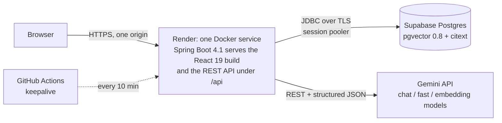
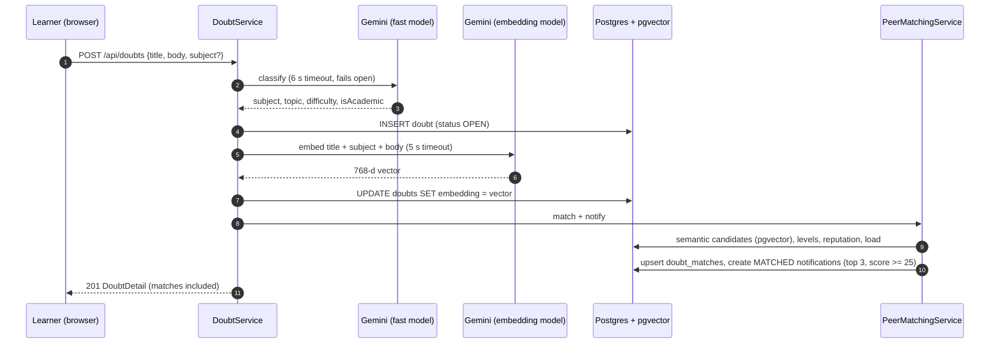
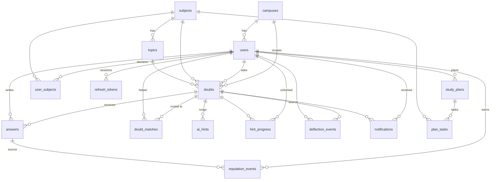
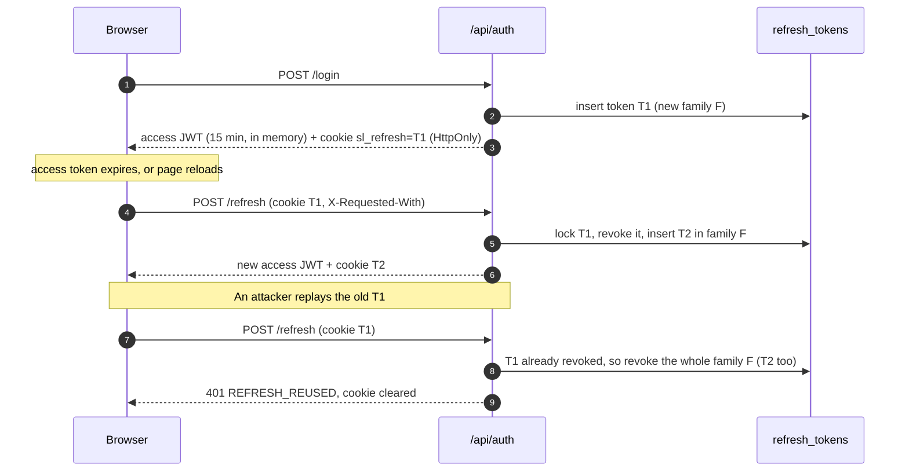

# StudyLoop architecture

This document explains how the pieces fit together and why the algorithms are shaped the way they are. Everything here
describes code that is in this repository.

## 1. System overview



- **Same-origin by design.** The root `Dockerfile` builds the React app and bundles it into the Spring Boot jar, so the
  UI and `/api` share one origin and the refresh cookie is first-party. This avoids CORS in production and the
  third-party-cookie problems in Safari. Hashed assets are served with a one-year immutable cache, every other non-API
  path without a file extension falls back to `index.html`, and `/api/**` is never rewritten (`WebConfig`). The split
  layout (API-only `backend/Dockerfile` on Render, SPA on Vercel with the `/api` rewrite in `frontend/vercel.json`)
  still works. CORS is only configured for local development without the Vite proxy.
- **Polling, not WebSockets.** The bell polls `/api/notifications/unread-count` every 15 seconds. Polling survives
  proxies and free-tier hosting, and a 15 second delay is invisible for "a senior answered your doubt".
- **No Spring AI or LLM SDK.** Gemini is called with `RestClient`, so timeouts, retries and structured output are
  explicit and testable (see `GeminiClientTest`, which runs the real client against a local stand-in server).

## 2. Posting a doubt



Classification and embedding happen outside any database transaction, each with its own timeout, so a slow model can
never hold a connection or block a student from posting. If embedding fails the row keeps `embedding = NULL` and
`EmbeddingBackfillJob` fills it in later (20 rows every two minutes).

## 3. Data model



`ai_calls` (feature, model, latency, success) is standalone and feeds the Pulse "AI health" card.

Invariants live in SQL, not just in Java (`V1__schema.sql`, `V2__indexes.sql`):

| Invariant | Enforced by |
|---|---|
| One accepted answer per doubt | `UNIQUE INDEX ux_answers_one_accepted ON answers (doubt_id) WHERE is_accepted` |
| One active study plan per user | `UNIQUE INDEX ux_plans_one_active ON study_plans (user_id) WHERE is_active` |
| A subject is a strength or a need, never both | `UNIQUE (user_id, subject_id)` on `user_subjects` |
| Status and resolution agree | `CHECK solved_consistency` on `doubts` |
| Accepted flag and timestamp agree | `CHECK accepted_consistency` on `answers` |
| Reputation is awarded once per (user, reason, answer) | `UNIQUE (user_id, reason, source_answer_id)` on `reputation_events` |
| One deflection per (user, source doubt) | `UNIQUE (user_id, source_doubt_id)` |
| Schema never drifts from the entities | Flyway migrations + `spring.jpa.hibernate.ddl-auto=validate` |

Embeddings are `vector(768)`, L2-normalised before storage, searched with an HNSW index using cosine distance
(`similarity = 1 - (a <=> b)`). They are never mapped through JPA; all vector SQL lives in `EmbeddingStore`,
`MatchCandidateDao` and `PulseDao`.

Some tables are accessed with `JdbcTemplate` rather than JPA entities because they need `ON CONFLICT`, JSONB or array
columns, or are append-only ledgers: `doubt_matches`, `ai_hints`, `hint_progress`, `deflection_events`,
`reputation_events`, `ai_calls`. Entities are flat (plain id columns plus batched `UserLookup`), which is how the feed
stays at three SQL statements regardless of page size (`FeedQueryTest` asserts this).

## 4. Expertise routing (the matching algorithm)

For a new doubt, candidates are same-campus users (never the author) who either declared the subject as a strength or
have at least one accepted answer on a doubt in that subject. Each gets five signals in `[0, 1]`:

| Signal | Definition | Weight | Why |
|---|---|---|---|
| `semantic` | best cosine similarity between this doubt and doubts the candidate wrote the **accepted** answer for (last 180 days), rescaled with `clamp((sim - floor) / (ceil - floor))` | 0.40 | Self-declared level is gameable; solved similar doubts are evidence |
| `declared` | `level / 5` if the candidate marked the subject as STRONG, else 0 | 0.20 | Useful for new helpers with no history |
| `reputation` | `ln(1 + subjectRep) / ln(1 + maxSubjectRepOnCampus)` | 0.20 | Log scale so one veteran does not drown everyone else |
| `recency` | active within 24 h = 1.0, 72 h = 0.6, 7 d = 0.3, otherwise 0 | 0.20 | A great helper who left last month will not answer tonight |
| `load` | `min(openMatches, 3) / 3`, open matches in the last 48 h that the candidate has not answered | -15 points | Spreads questions across helpers instead of burying the top one |

```
score = clamp(round(100 * (0.40*semantic + 0.20*declared + 0.20*reputation + 0.20*recency) - 15*load), 0, 100)
```

Ties break on `semantic`, then `reputation`, then lowest id. The top five are stored; ranks 1 to 3 with
`score >= 25` get one `MATCHED` notification each, and never twice (`doubt_matches.notified`). Every match carries a
`breakdown` and up to three human-readable `reasons`, which is what the "Why this match?" panel shows.

Unanswered doubts get one more routing pass between 30 and 180 minutes after posting (`RematchJob`).

## 5. The hint ladder

Four rungs, generated one at a time and **shared per doubt**: the second student to open rung 2 pays nothing
(`fromCache: true`). Progress is per user (`hint_progress`).

1. **Nudge** - guiding questions or the one key idea; no formulas applied, no code, no answer.
2. **Approach** - the strategy in a few steps, naming the technique and one pitfall.
3. **First step worked** - carries out the first meaningful step on the student's exact problem, then stops.
4. **Full solution** - complete worked solution, with `**Answer:**`, `**Common mistake:**` and `**Try this:**`.

Grounding: the top three **solved doubts on the same campus with a peer-accepted answer** and
`similarity >= grounding threshold` are placed in the prompt as `CAMPUS KNOWLEDGE` with their ids. The model may cite
them as `[#id]`. After generation the server **drops any citation whose id was not provided and strips its inline
marker** (`HintService.sanitize`, covered by `HintServiceTest`). If the model is unavailable nothing is persisted and the
learner's level does not advance; they get a clear 503 message.

The rule "rungs 1 to 3 never contain the final answer" is enforced by the prompt (verbatim in `Prompts.HINT_SYSTEM`);
it cannot be asserted in code, so it is worth spot-checking with the real model.

## 6. Authentication and token rotation



- Access tokens are HS256 JWTs signed with `JWT_SECRET`, validated by Spring's Nimbus resource server (issuer
  `studyloop`). The frontend keeps them in memory only.
- Refresh tokens are 32 random bytes; only their SHA-256 is stored. The cookie is `HttpOnly`, `SameSite=Lax`,
  scoped to `/api/auth`, and `Secure` when `COOKIE_SECURE=true`.
- The reuse-detection revoke has to commit even though the request ends in an error, hence
  `@Transactional(noRollbackFor = ApiException.class)` on `TokenService.rotate`.
- `refresh` and `logout` are the only cookie-authenticated state-changing endpoints, so they require the header
  `X-Requested-With: StudyLoop` instead of CSRF tokens.
- Concurrent refreshes from one tab are collapsed into a single request on the client (`refreshSession()` shares one
  promise), otherwise legitimate parallel 401s would look like token reuse.
- **Reuse grace (15 s).** Some races cannot be fixed on the client: a reload while a refresh is in flight (common while
  a free-tier instance is waking up) discards the rotated cookie, and two tabs can boot at the same moment. The browser
  then presents the token that was rotated a moment ago. If that token was rotated less than 15 seconds ago *and* its
  family still has an active token, `TokenService.rotate` issues a sibling token in the same family instead of
  revoking it. After logout or a detected reuse the family has no active token, so a replay is rejected exactly as
  before. This is the same trade-off as the "reuse interval" in Auth0 and Okta refresh-token rotation.

## 7. Reputation ledger

`users.reputation` is a denormalised sum of `reputation_events`. A point is added only when the ledger insert
(`ON CONFLICT (user_id, reason, source_answer_id) DO NOTHING`) actually inserted a row, in the same transaction. That
makes accept and rating idempotent and keeps `SUM(delta) == users.reputation` (asserted in the concurrency test).

| Reason | Who | Points |
|---|---|---|
| `ANSWER_ACCEPTED` | helper | +15 |
| `FAST_ANSWER` | helper, if the answer came within 30 minutes of the doubt | +5 |
| `HELPFUL_RATING` | helper, when the asker rates 4 or 5 stars | +5 |
| `LOOP_CLOSED` | asker, when they accept an answer | +2 |

Accepting an answer takes `SELECT ... FOR UPDATE` on the doubt row, so two concurrent accepts serialise and exactly one
wins; the partial unique index is the last line of defence.

## 8. Similarity thresholds and calibration

The duplicate radar, hint grounding and the semantic matching score depend on cosine similarity, and the right numbers
depend on the embedding model.

| Setting | Gemini (`SIM_*`) | Fake AI, no key (`SIM_FAKE_*`) | Test profile |
|---|---|---|---|
| Duplicate threshold | 0.80 | 0.45 | 0.65 |
| Grounding threshold | 0.65 | 0.30 | 0.40 |
| Semantic floor | 0.50 | 0.20 | 0.25 |
| Semantic ceiling | 0.90 | 0.60 | 0.75 |

`AppProperties.similarity()` returns the `SIM_FAKE_*` set automatically whenever `GEMINI_API_KEY` is blank, so a
deployment without a key still shows the radar, grounded hints and evidence-based routing, and adding a key switches to
the Gemini set without touching any other variable.

The **Gemini column has not been calibrated against live `gemini-embedding-2` scores** (no API key was available while
this was built); those are the starting values from the build specification. The **fake column was measured** on the
seeded campus with the bag-of-words fake embedder: a reworded version of the BCNF exemplar scores 0.56 against it while
the closest non-duplicate (a different normalization question) scores 0.33; a reworded producer-consumer deadlock
question scores 0.50 against its exemplar and 0.34 against the closest unrelated doubt. Heavy paraphrases with few
shared words fall below 0.45; that is a limit of the fake embedder, not of the radar.

To calibrate with a real key: collect 10 known-duplicate pairs and 10 unrelated pairs from the seed data, set
`SIM_DUPLICATE_THRESHOLD` midway between the lowest duplicate and the highest unrelated score,
`SIM_GROUNDING_THRESHOLD` 0.10 lower, and `SIM_SEMANTIC_FLOOR`/`CEIL` at the 10th and 90th percentile of all
accepted-answer similarities. Record the chosen values here:

| Setting | Calibrated value | Date | Who |
|---|---|---|---|
| `SIM_DUPLICATE_THRESHOLD` | _to be filled after calibration_ | | |
| `SIM_GROUNDING_THRESHOLD` | _to be filled after calibration_ | | |
| `SIM_SEMANTIC_FLOOR` | _to be filled after calibration_ | | |
| `SIM_SEMANTIC_CEIL` | _to be filled after calibration_ | | |

## 9. Embedding space and model resolution

Vectors are only comparable when the same model produced them. Two situations break that silently: a deployment that
starts without `GEMINI_API_KEY` (fake vectors) and gets a key later, and a Gemini model being renamed or replaced.

- **Every vector records its model.** `V4__embedding_model.sql` adds `doubts.embedding_model`; `EmbeddingStore`
  writes the producing model's id (`EmbeddingClient.modelId()`, `fake-bow-768` for the fake) with every vector.
- **Startup guard.** `EmbeddingSpaceGuard` runs after the demo seeder: it clears every vector whose model differs from
  the current one, then re-embeds all missing vectors in batches of 50. Cleared rows have `embedding IS NULL`, which
  every similarity query already excludes, so old and new vectors are never compared even for a moment. If Gemini is
  unavailable, `EmbeddingBackfillJob` keeps filling them in every two minutes.
- **Readiness.** `/api/health` answers `503 STARTING` until the seeder and the guard are done, so the platform health
  check does not send traffic to an empty or half-embedded campus.
- **Model resolution.** `GeminiModelResolver` lists the Gemini models once at startup and resolves each configured id:
  the exact id if it is listed with the required method (`generateContent` or `embedContent`), otherwise the closest
  listed variant (the id with `-preview` added or removed, then the shortest listed id that extends it). A substitution
  is logged as a warning; nothing is hard-coded, and an unknown id is kept (calls then fail with `AI_CONFIG`, now also
  for HTTP 404).

## 10. Deployment

| Piece | Where | Notes |
|---|---|---|
| App (SPA + API) | Render web service, Docker, Singapore | Root `Dockerfile`: Node 22 builds the SPA, Maven builds the jar with the SPA in `static/`, JRE 21 runs it with `-XX:MaxRAMPercentage=70 -XX:+UseSerialGC` for the 512 MB instance |
| Database | Supabase Postgres, `ap-southeast-1` | Dedicated `studyloop_app` login role that owns a `studyloop` schema (outside Supabase's public Data API), `search_path = studyloop, extensions`; `vector` and `citext` live in `extensions`. Connected through the IPv4 session pooler with TLS (`sslmode=require`) |
| Migrations | Flyway V1 to V4 on startup | `ddl-auto=validate`; the demo campus seeds itself on an empty database |
| Uptime | `.github/workflows/keepalive.yml` | Pings `/api/health` every 10 minutes; GitHub may delay scheduled runs, so an external 5-minute monitor (UptimeRobot) or a paid instance removes cold starts entirely |

Changing hosts only means changing `DATABASE_URL`, `DATABASE_USER` and `DATABASE_PASSWORD` (any Postgres 15+ with
pgvector and citext works, for example Neon).

